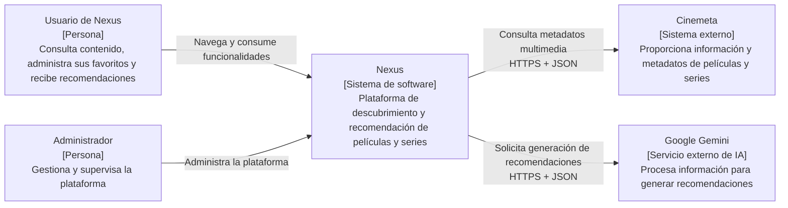
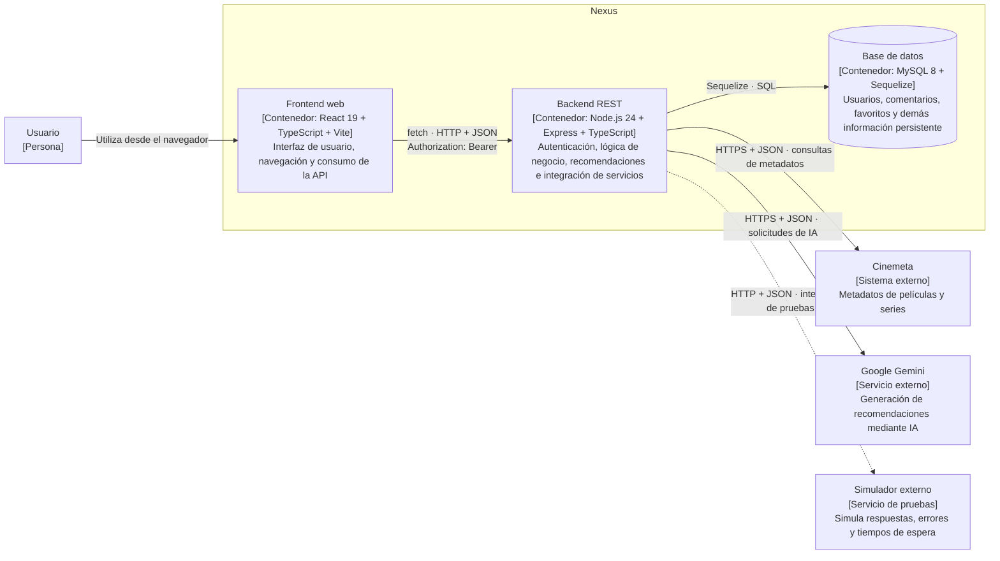

# Arquitectura

Nexus utiliza una arquitectura cliente-servidor distribuida, organizada en contenedores independientes. El frontend consume una API REST mediante HTTP y JSON; el backend concentra la lógica de negocio, autenticación e integración con servicios externos, mientras que MySQL almacena la información persistente.

## Nivel 1 · Contexto: quién usa el sistema y con qué otros sistemas habla

## Nivel 2 · Contenedores: las piezas que se ejecutan por separado

## Qué pasa si algo falla

| Si falla...                                                       | Qué responde la API                                                  | Por qué                                                                                         |
| ----------------------------------------------------------------- | -------------------------------------------------------------------- | ----------------------------------------------------------------------------------------------- |
| Cinemeta tarda más del tiempo de espera establecido (8 segundos). | **504 Gateway Timeout**                                              | La API no recibió una respuesta dentro del tiempo permitido para la consulta externa.           |
| Cinemeta devuelve una respuesta inválida o un error inesperado.   | **502 Bad Gateway**                                                  | La API recibió una respuesta incorrecta del servicio externo.                                   |
| Gemini no está disponible temporalmente.                          | **503 Service Unavailable** o mecanismo alternativo                  | La generación de recomendaciones mediante IA no puede realizarse temporalmente.                 |
| No está configurada la clave de Gemini.                           | Se utiliza el comportamiento alternativo sin IA, si está habilitado. | La plataforma debe poder gestionar la ausencia de IA sin comprometer las demás funcionalidades. |
| MySQL no está disponible.                                         | **503 Service Unavailable** o error controlado equivalente.          | El backend no puede consultar ni persistir información.                                         |
| El usuario envía un token inválido o expirado.                    | **401 Unauthorized**                                                 | La solicitud no cuenta con una autenticación válida.                                            |
| El usuario intenta acceder a un recurso sin permisos.             | **403 Forbidden**                                                    | La identidad está autenticada, pero no tiene autorización para realizar la operación.           |

## Consideraciones arquitectónicas

- **Separación de responsabilidades:** el frontend se encarga de la presentación y el backend de las reglas de negocio y el acceso a los datos.
- **Comunicación:** el frontend y los servicios externos se comunican mediante HTTP; las solicitudes y respuestas de la API utilizan JSON.
- **Persistencia:** Sequelize administra la comunicación entre el backend y MySQL.
- **Autenticación:** las rutas protegidas utilizan tokens JWT mediante el encabezado `Authorization: Bearer`.
- **Integraciones externas:** Cinemeta proporciona información multimedia y Gemini permite generar recomendaciones mediante inteligencia artificial.
- **Tolerancia a fallos:** las integraciones externas deben controlar errores, tiempos de espera y respuestas inesperadas para evitar que una falla externa comprometa toda la plataforma.
